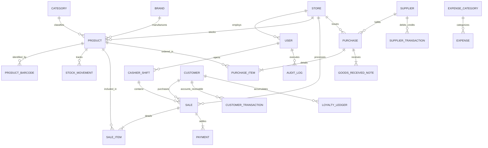

# 🗄️ MINI MARKET — DATABASE DESIGN SPECIFICATION

**Document Version**: 1.0.0  
**Target RDBMS**: PostgreSQL 16+ (Production) / SQLite 3.40+ (Development & Local Offline Storage)  
**ORM**: Django ORM (Backend) / SQLite & Sqflite (Flutter Client Cache)  

---

## 1. Entity-Relationship Overview



---

## 2. Core Relational Schema Specifications

### 2.1 Store & Organization (`apps.core`)
```sql
CREATE TABLE core_store (
    id UUID PRIMARY KEY,
    name VARCHAR(150) NOT NULL,
    legal_business_name VARCHAR(200) NOT NULL,
    tax_identification_number VARCHAR(50),
    email VARCHAR(100),
    phone VARCHAR(30),
    address TEXT NOT NULL,
    currency_code VARCHAR(3) DEFAULT 'USD',
    currency_symbol VARCHAR(5) DEFAULT '$',
    tax_rate DECIMAL(5,2) DEFAULT 0.00,
    is_tax_inclusive BOOLEAN DEFAULT TRUE,
    created_at TIMESTAMP WITH TIME ZONE DEFAULT CURRENT_TIMESTAMP,
    updated_at TIMESTAMP WITH TIME ZONE DEFAULT CURRENT_TIMESTAMP
);
```

### 2.2 Users, Roles & Cashier Shifts (`apps.accounts`)
```sql
CREATE TABLE accounts_role (
    id UUID PRIMARY KEY,
    name VARCHAR(50) UNIQUE NOT NULL, -- 'ADMIN', 'MANAGER', 'CASHIER', 'INVENTORY', 'ACCOUNTANT'
    permissions JSONB NOT NULL DEFAULT '[]',
    description TEXT
);

CREATE TABLE accounts_user (
    id UUID PRIMARY KEY,
    store_id UUID REFERENCES core_store(id) ON DELETE CASCADE,
    role_id UUID REFERENCES accounts_role(id),
    username VARCHAR(150) UNIQUE NOT NULL,
    email VARCHAR(255) UNIQUE,
    first_name VARCHAR(100),
    last_name VARCHAR(100),
    phone_number VARCHAR(30),
    pin_hash VARCHAR(255), -- Fast 4-digit cashier login
    is_active BOOLEAN DEFAULT TRUE,
    is_staff BOOLEAN DEFAULT FALSE,
    created_at TIMESTAMP WITH TIME ZONE DEFAULT CURRENT_TIMESTAMP
);

CREATE TABLE pos_cashiershift (
    id UUID PRIMARY KEY,
    store_id UUID REFERENCES core_store(id),
    cashier_id UUID REFERENCES accounts_user(id),
    start_time TIMESTAMP WITH TIME ZONE NOT NULL,
    end_time TIMESTAMP WITH TIME ZONE,
    opening_cash DECIMAL(12,2) NOT NULL,
    expected_cash DECIMAL(12,2) DEFAULT 0.00,
    actual_cash DECIMAL(12,2),
    cash_difference DECIMAL(12,2) DEFAULT 0.00,
    notes TEXT,
    status VARCHAR(20) DEFAULT 'OPEN' -- 'OPEN', 'CLOSED', 'RECONCILED'
);
```

### 2.3 Product Catalog, Categories & Barcodes (`apps.products`)
```sql
CREATE TABLE products_category (
    id UUID PRIMARY KEY,
    store_id UUID REFERENCES core_store(id),
    parent_id UUID REFERENCES products_category(id) ON DELETE SET NULL,
    name VARCHAR(100) NOT NULL,
    slug VARCHAR(120) NOT NULL,
    image_url TEXT,
    color_code VARCHAR(10),
    is_active BOOLEAN DEFAULT TRUE,
    created_at TIMESTAMP WITH TIME ZONE DEFAULT CURRENT_TIMESTAMP,
    UNIQUE(store_id, slug)
);

CREATE TABLE products_brand (
    id UUID PRIMARY KEY,
    store_id UUID REFERENCES core_store(id),
    name VARCHAR(100) NOT NULL,
    logo_url TEXT,
    created_at TIMESTAMP WITH TIME ZONE DEFAULT CURRENT_TIMESTAMP
);

CREATE TABLE products_product (
    id UUID PRIMARY KEY,
    store_id UUID REFERENCES core_store(id) ON DELETE CASCADE,
    category_id UUID REFERENCES products_category(id) ON DELETE RESTRICT,
    brand_id UUID REFERENCES products_brand(id) ON DELETE SET NULL,
    name VARCHAR(255) NOT NULL,
    sku VARCHAR(100) NOT NULL,
    primary_barcode VARCHAR(100) NOT NULL,
    description TEXT,
    unit_of_measure VARCHAR(20) DEFAULT 'PIECE', -- 'PIECE', 'KG', 'LITER', 'PACK', 'BOX'
    cost_price DECIMAL(12,2) NOT NULL DEFAULT 0.00,
    selling_price DECIMAL(12,2) NOT NULL DEFAULT 0.00,
    wholesale_price DECIMAL(12,2),
    tax_rate DECIMAL(5,2) DEFAULT 0.00,
    current_stock DECIMAL(12,3) NOT NULL DEFAULT 0.000,
    min_stock_alert DECIMAL(12,3) DEFAULT 5.000,
    max_stock_threshold DECIMAL(12,3),
    image_url TEXT,
    has_variants BOOLEAN DEFAULT FALSE,
    is_active BOOLEAN DEFAULT TRUE,
    created_at TIMESTAMP WITH TIME ZONE DEFAULT CURRENT_TIMESTAMP,
    updated_at TIMESTAMP WITH TIME ZONE DEFAULT CURRENT_TIMESTAMP,
    UNIQUE(store_id, sku),
    UNIQUE(store_id, primary_barcode)
);

CREATE TABLE products_productbarcode (
    id UUID PRIMARY KEY,
    product_id UUID REFERENCES products_product(id) ON DELETE CASCADE,
    barcode VARCHAR(100) NOT NULL,
    barcode_type VARCHAR(20) DEFAULT 'EAN13', -- 'EAN13', 'UPC', 'CODE128', 'QR'
    is_primary BOOLEAN DEFAULT FALSE,
    UNIQUE(product_id, barcode)
);
```

### 2.4 Inventory & Stock Movements (`apps.inventory`)
```sql
CREATE TABLE inventory_stockmovement (
    id UUID PRIMARY KEY,
    store_id UUID REFERENCES core_store(id),
    product_id UUID REFERENCES products_product(id) ON DELETE RESTRICT,
    user_id UUID REFERENCES accounts_user(id),
    movement_type VARCHAR(30) NOT NULL, -- 'SALE', 'PURCHASE_RECEIPT', 'AUDIT_ADJUSTMENT', 'DAMAGE', 'RETURN', 'TRANSFER'
    quantity DECIMAL(12,3) NOT NULL, -- Positive for addition, negative for deduction
    cost_per_unit DECIMAL(12,2) NOT NULL,
    balance_after DECIMAL(12,3) NOT NULL,
    reference_id UUID, -- Links to SaleID, PurchaseID, or AuditID
    reason TEXT,
    created_at TIMESTAMP WITH TIME ZONE DEFAULT CURRENT_TIMESTAMP
);
CREATE INDEX idx_stockmovement_product ON inventory_stockmovement(product_id, created_at DESC);
```

### 2.5 Point of Sale & Transactions (`apps.pos`)
```sql
CREATE TABLE pos_sale (
    id UUID PRIMARY KEY,
    store_id UUID REFERENCES core_store(id),
    shift_id UUID REFERENCES pos_cashiershift(id),
    cashier_id UUID REFERENCES accounts_user(id),
    customer_id UUID, -- NULL for walk-in customer
    receipt_number VARCHAR(50) UNIQUE NOT NULL,
    subtotal DECIMAL(12,2) NOT NULL,
    discount_amount DECIMAL(12,2) DEFAULT 0.00,
    discount_reason VARCHAR(100),
    tax_amount DECIMAL(12,2) DEFAULT 0.00,
    grand_total DECIMAL(12,2) NOT NULL,
    amount_paid DECIMAL(12,2) NOT NULL,
    change_given DECIMAL(12,2) DEFAULT 0.00,
    payment_status VARCHAR(20) DEFAULT 'PAID', -- 'PAID', 'PARTIAL', 'CREDIT', 'REFUNDED'
    status VARCHAR(20) DEFAULT 'COMPLETED', -- 'COMPLETED', 'VOIDED', 'REFUNDED'
    created_at TIMESTAMP WITH TIME ZONE DEFAULT CURRENT_TIMESTAMP
);

CREATE TABLE pos_saleitem (
    id UUID PRIMARY KEY,
    sale_id UUID REFERENCES pos_sale(id) ON DELETE CASCADE,
    product_id UUID REFERENCES products_product(id) ON DELETE RESTRICT,
    product_name VARCHAR(255) NOT NULL,
    product_sku VARCHAR(100) NOT NULL,
    cost_price DECIMAL(12,2) NOT NULL,
    unit_price DECIMAL(12,2) NOT NULL,
    quantity DECIMAL(12,3) NOT NULL,
    discount_amount DECIMAL(12,2) DEFAULT 0.00,
    tax_rate DECIMAL(5,2) DEFAULT 0.00,
    tax_amount DECIMAL(12,2) DEFAULT 0.00,
    line_total DECIMAL(12,2) NOT NULL
);

CREATE TABLE pos_payment (
    id UUID PRIMARY KEY,
    sale_id UUID REFERENCES pos_sale(id) ON DELETE CASCADE,
    payment_method VARCHAR(30) NOT NULL, -- 'CASH', 'CREDIT_CARD', 'MOBILE_MONEY', 'STORE_CREDIT', 'SPLIT'
    amount DECIMAL(12,2) NOT NULL,
    reference_number VARCHAR(100),
    created_at TIMESTAMP WITH TIME ZONE DEFAULT CURRENT_TIMESTAMP
);
```

### 2.6 Purchasing & Suppliers (`apps.purchases` & `apps.suppliers`)
```sql
CREATE TABLE suppliers_supplier (
    id UUID PRIMARY KEY,
    store_id UUID REFERENCES core_store(id),
    company_name VARCHAR(200) NOT NULL,
    contact_person VARCHAR(100),
    email VARCHAR(100),
    phone VARCHAR(30) NOT NULL,
    address TEXT,
    tax_number VARCHAR(50),
    payment_terms_days INTEGER DEFAULT 30,
    outstanding_balance DECIMAL(12,2) DEFAULT 0.00,
    is_active BOOLEAN DEFAULT TRUE,
    created_at TIMESTAMP WITH TIME ZONE DEFAULT CURRENT_TIMESTAMP
);

CREATE TABLE purchases_purchaseorder (
    id UUID PRIMARY KEY,
    store_id UUID REFERENCES core_store(id),
    supplier_id UUID REFERENCES suppliers_supplier(id) ON DELETE RESTRICT,
    created_by UUID REFERENCES accounts_user(id),
    order_number VARCHAR(50) UNIQUE NOT NULL,
    status VARCHAR(30) DEFAULT 'DRAFT', -- 'DRAFT', 'ORDERED', 'PARTIALLY_RECEIVED', 'RECEIVED', 'CANCELLED'
    total_cost DECIMAL(12,2) NOT NULL DEFAULT 0.00,
    expected_delivery_date DATE,
    notes TEXT,
    created_at TIMESTAMP WITH TIME ZONE DEFAULT CURRENT_TIMESTAMP
);

CREATE TABLE purchases_purchaseitem (
    id UUID PRIMARY KEY,
    purchase_order_id UUID REFERENCES purchases_purchaseorder(id) ON DELETE CASCADE,
    product_id UUID REFERENCES products_product(id) ON DELETE RESTRICT,
    quantity_ordered DECIMAL(12,3) NOT NULL,
    quantity_received DECIMAL(12,3) DEFAULT 0.000,
    unit_cost DECIMAL(12,2) NOT NULL,
    subtotal DECIMAL(12,2) NOT NULL
);
```

### 2.7 Customers & Loyalty CRM (`apps.customers`)
```sql
CREATE TABLE customers_customer (
    id UUID PRIMARY KEY,
    store_id UUID REFERENCES core_store(id),
    name VARCHAR(150) NOT NULL,
    phone VARCHAR(30) UNIQUE,
    email VARCHAR(100),
    credit_limit DECIMAL(12,2) DEFAULT 0.00,
    current_credit DECIMAL(12,2) DEFAULT 0.00,
    loyalty_points INTEGER DEFAULT 0,
    is_active BOOLEAN DEFAULT TRUE,
    created_at TIMESTAMP WITH TIME ZONE DEFAULT CURRENT_TIMESTAMP
);
```

### 2.8 Expenses & Cash Ledger (`apps.expenses`)
```sql
CREATE TABLE expenses_expensecategory (
    id UUID PRIMARY KEY,
    store_id UUID REFERENCES core_store(id),
    name VARCHAR(100) NOT NULL,
    description TEXT
);

CREATE TABLE expenses_expense (
    id UUID PRIMARY KEY,
    store_id UUID REFERENCES core_store(id),
    category_id UUID REFERENCES expenses_expensecategory(id),
    created_by UUID REFERENCES accounts_user(id),
    title VARCHAR(200) NOT NULL,
    amount DECIMAL(12,2) NOT NULL,
    payment_method VARCHAR(30) DEFAULT 'CASH',
    receipt_image_url TEXT,
    notes TEXT,
    expense_date DATE NOT NULL,
    created_at TIMESTAMP WITH TIME ZONE DEFAULT CURRENT_TIMESTAMP
);
```

### 2.9 Immutable Audit Logging (`apps.audit`)
```sql
CREATE TABLE audit_auditlog (
    id UUID PRIMARY KEY,
    store_id UUID REFERENCES core_store(id),
    user_id UUID REFERENCES accounts_user(id) ON DELETE SET NULL,
    action VARCHAR(50) NOT NULL, -- 'SALE_COMPLETED', 'STOCK_ADJUSTED', 'PRICE_CHANGED', 'DRAWER_OPENED', 'LOGIN'
    entity_name VARCHAR(100) NOT NULL,
    entity_id UUID NOT NULL,
    previous_state JSONB,
    new_state JSONB,
    ip_address VARCHAR(50),
    created_at TIMESTAMP WITH TIME ZONE DEFAULT CURRENT_TIMESTAMP
);
CREATE INDEX idx_audit_created ON audit_auditlog(store_id, created_at DESC);
```
