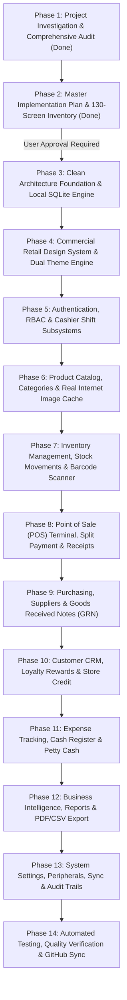

# 📋 MINI MARKET — MASTER IMPLEMENTATION PLAN & 100+ SCREEN INVENTORY

**Document Version**: 1.0.0  
**Target Scope**: Complete Commercial-Grade Mini Market & Retail Business Management System  
**Frameworks**: Flutter 3.x (Multi-Platform Client) + Django 5.x / Django REST Framework (Backend)  

---

## 1. Executive Strategy

This master implementation plan establishes the roadmap to transform **Mini Market** from a visual prototype into an enterprise-ready retail operations platform. The plan covers:
1. Complete separation of frontend concerns into Clean Architecture with offline-first SQLite synchronization.
2. A full Django REST Framework backend with atomic database transactions, decimal-safe financial calculations, and role-based access control.
3. A commercial retail UI/UX design system supporting both **OLED Dark Mode** and **Executive Light Mode** across mobile, tablet POS, and desktop form factors.
4. Over **130 professionally designed, purpose-driven screens** covering every aspect of retail operations.

---

## 2. 100+ Comprehensive Screen Inventory (130 Purpose-Driven Screens)

### Module 1: Authentication, Onboarding & Security (8 Screens)
| # | Screen Name | Purpose | User Role | Main Functionality | Related Endpoints | Related Entities | Priority |
|---|---|---|---|---|---|---|---|
| 1 | `LoginScreen` | Standard credential authentication | All | Email/Username + password login, remember me | `POST /api/accounts/token/` | `User` | P1 |
| 2 | `CashierPinLoginScreen` | High-speed terminal lock screen | Cashier, Manager | 4-digit numeric keypad for rapid cashier switching | `POST /api/accounts/pin-login/` | `User`, `CashierShift` | P1 |
| 3 | `RegisterStoreScreen` | New business initial setup | Admin | Store registration, business name, currency, tax setup | `POST /api/core/store/` | `Store`, `User` | P1 |
| 4 | `ForgotPasswordScreen` | Account recovery | All | Email password reset request | `POST /api/accounts/password-reset/` | `User` | P2 |
| 5 | `ResetPasswordScreen` | Password change with token | All | Set new password with confirmation | `POST /api/accounts/password-reset/confirm/` | `User` | P2 |
| 6 | `TwoFactorAuthScreen` | Enhanced security verification | Admin, Manager | OTP code entry for sensitive administrative operations | `POST /api/accounts/2fa/verify/` | `User` | P2 |
| 7 | `TerminalLockScreen` | Inactivity security guard | All | Blurs screen data, requires quick PIN or password to unlock | Client-side security | `UserSession` | P1 |
| 8 | `UserSessionHistoryScreen` | Security audit of active devices | Admin | View logged-in devices, IP addresses, revoke sessions | `GET /api/accounts/sessions/` | `UserSession` | P3 |

### Module 2: Dashboard & Executive Business Overview (6 Screens)
| # | Screen Name | Purpose | User Role | Main Functionality | Related Endpoints | Related Entities | Priority |
|---|---|---|---|---|---|---|---|
| 9 | `ExecutiveDashboardScreen` | Overall store performance KPI hub | Admin, Owner | Real-time sales, gross profit, cash in drawer, stock alert counters | `GET /api/reports/dashboard/summary/` | `Sale`, `Expense`, `Product` | P1 |
| 10| `CashierDashboardScreen` | Shift-focused cashier home | Cashier | Today's shift sales, transaction count, active cart access, drawer status | `GET /api/pos/shifts/active/` | `CashierShift`, `Sale` | P1 |
| 11| `InventoryDashboardScreen` | Stock health overview | Inventory Mgr | Low stock alert count, expired items, out of stock count, inventory valuation | `GET /api/inventory/dashboard/` | `Product`, `StockMovement` | P1 |
| 12| `SalesTrendDashboardScreen` | Revenue velocity charts | Manager, Admin | Hourly sales curves, weekday comparisons, top-performing hours | `GET /api/reports/sales-trends/` | `Sale` | P2 |
| 13| `ProfitLossOverviewScreen` | Real-time margin calculator | Accountant, Admin| Today's vs this week's gross and net profit after operational expenses | `GET /api/reports/profit-loss/` | `SaleItem`, `Expense` | P2 |
| 14| `StoreNotificationsScreen` | Actionable business alert feed | All | Low stock alerts, large transactions, shift handover alerts, backup notices | `GET /api/core/notifications/` | `Notification` | P1 |

### Module 3: Point of Sale (POS) & Checkout Operations (12 Screens)
| # | Screen Name | Purpose | User Role | Main Functionality | Related Endpoints | Related Entities | Priority |
|---|---|---|---|---|---|---|---|
| 15| `POSTerminalScreen` | Core cashier sales interface | Cashier | Barcode scan, quick category tabs, product search, cart summary, split view | `GET /api/products/items/` | `Product`, `Sale` | P1 |
| 16| `POSBarcodeScannerScreen` | Fullscreen camera barcode scanner | Cashier | High-speed multi-barcode camera scanning with beep feedback | Client camera + `/api/products/scan/` | `ProductBarcode` | P1 |
| 17| `POSCartDrawerScreen` | Expanded cart modification | Cashier | Quantity steppers, line item discount, item removal, customer selection | Client state | `SaleItem` | P1 |
| 18| `POSPaymentModalScreen` | Payment method selection | Cashier | Cash, Credit Card, Mobile Money, Customer Credit, Split Payment | `POST /api/pos/checkout/` | `Payment`, `Sale` | P1 |
| 19| `POSCashCalculatorScreen` | Cash tender & change calculator | Cashier | Quick dollar bills ($5, $10, $20, $50, $100), change calculation | Client financial logic | `Payment` | P1 |
| 20| `POSSplitPaymentScreen` | Multi-tender payment division | Cashier | Divide bill across multiple methods (e.g. $20 Cash + $35 Card) | `POST /api/pos/checkout/split/` | `Payment` | P2 |
| 21| `POSHoldCartsScreen` | Parked cart management | Cashier | Hold current order while customer grabs more items, recall parked orders | `GET/POST /api/pos/held-carts/` | `HeldCart` | P1 |
| 22| `POSCustomerSelectScreen` | Attach customer to sale | Cashier | Quick search customer by phone or name, loyalty points balance | `GET /api/customers/` | `Customer` | P1 |
| 23| `POSDiscountOverrideScreen` | Order-level discount modal | Manager | Percentage or fixed discount with mandatory manager PIN authorization | Client authorization | `Sale` | P2 |
| 24| `POSSaleCompleteScreen` | Transaction success & receipt | Cashier | Success graphic, change amount, print receipt, SMS/email digital receipt | `GET /api/pos/sales/{id}/receipt/`| `Sale`, `Receipt` | P1 |
| 25| `POSShiftOpenScreen` | Opening float registration | Cashier | Enter opening cash amount in drawer before selling | `POST /api/pos/shifts/open/` | `CashierShift` | P1 |
| 26| `POSShiftCloseScreen` | End of shift reconciliation | Cashier, Manager | Count cash in drawer, compare expected vs counted cash, print Z-report | `POST /api/pos/shifts/{id}/close/` | `CashierShift` | P1 |

### Module 4: Product & Catalog Management (12 Screens)
| # | Screen Name | Purpose | User Role | Main Functionality | Related Endpoints | Related Entities | Priority |
|---|---|---|---|---|---|---|---|
| 27| `ProductListScreen` | Master catalog browser | All | Filter by category, brand, stock status, search by name/barcode | `GET /api/products/items/` | `Product` | P1 |
| 28| `ProductDetailScreen` | Complete product profile | All | Full specifications, stock history, price history, supplier, barcode list | `GET /api/products/items/{id}/` | `Product`, `StockMovement` | P1 |
| 29| `ProductAddScreen` | Create new catalog item | Manager, Admin | Name, SKU, barcode, category, brand, cost, selling price, min stock, image | `POST /api/products/items/` | `Product` | P1 |
| 30| `ProductEditScreen` | Update existing product | Manager, Admin | Modify pricing, descriptions, thresholds, update image | `PUT /api/products/items/{id}/` | `Product` | P1 |
| 31| `ProductBarcodeManagerScreen`| Secondary barcode editor | Inventory, Mgr | Assign multiple barcodes to a single SKU (e.g. multi-packs, promo packs) | `GET/POST /api/products/barcodes/`| `ProductBarcode` | P2 |
| 32| `ProductBulkImportScreen` | Batch upload spreadsheet | Admin | Upload CSV/Excel product catalog with validation preview & error report | `POST /api/products/bulk-import/`| `Product` | P2 |
| 33| `ProductExportScreen` | Download catalog data | Admin, Manager | Export products to CSV or Excel with filter criteria | `GET /api/products/export/` | `Product` | P2 |
| 34| `ProductPriceAdjustmentScreen`| Batch price updater | Admin, Manager | Increase/decrease prices across a whole category by % or fixed amount | `POST /api/products/batch-price/` | `Product` | P2 |
| 35| `ProductStockHistoryScreen` | Product-specific movement audit | Manager, Admin | Chronological log of every sale, purchase receipt, and audit adjustment | `GET /api/inventory/movements/?p=`| `StockMovement` | P1 |
| 36| `ProductPrintLabelsScreen` | Barcode label generation | Inventory, Mgr | Select products to generate printable barcode shelf tags and sticker sheets | `POST /api/products/print-labels/`| `Product` | P2 |
| 37| `ProductArchivedScreen` | Deactivated items list | Admin | View archived products, restore to catalog, permanently remove | `GET /api/products/archived/` | `Product` | P3 |
| 38| `ProductImageGalleryScreen` | Product image browser & upload | Manager, Admin | Pick internet CDN image or capture photo, crop and save product visual | `POST /api/products/upload-image/`| `Product` | P1 |

### Module 5: Categories & Brand Management (6 Screens)
| # | Screen Name | Purpose | User Role | Main Functionality | Related Endpoints | Related Entities | Priority |
|---|---|---|---|---|---|---|---|
| 39| `CategoryListScreen` | Department & category tree | All | Grid/list of retail categories (Dairy, Produce, Beverages, etc.) | `GET /api/products/categories/` | `Category` | P1 |
| 40| `CategoryAddScreen` | Create retail department | Manager, Admin | Name, parent category, category image URL, display color badge | `POST /api/products/categories/` | `Category` | P1 |
| 41| `CategoryEditScreen` | Modify category settings | Manager, Admin | Rename, change hierarchy, update image | `PUT /api/products/categories/{id}/`| `Category` | P1 |
| 42| `BrandListScreen` | Brand directory | All | List manufactured brands (Coca-Cola, Nestle, Unilever, etc.) | `GET /api/products/brands/` | `Brand` | P2 |
| 43| `BrandAddScreen` | Add new brand | Manager, Admin | Brand name, logo image URL, manufacturer notes | `POST /api/products/brands/` | `Brand` | P2 |
| 44| `CategoryProductsScreen` | Category-filtered product list | All | Focused catalog view of products inside a single selected department | `GET /api/products/items/?cat=` | `Product` | P1 |

### Module 6: Inventory & Stock Management (14 Screens)
| # | Screen Name | Purpose | User Role | Main Functionality | Related Endpoints | Related Entities | Priority |
|---|---|---|---|---|---|---|---|
| 45| `InventoryOverviewScreen` | Global inventory status | Inventory, Mgr | Total items, total retail value, total cost value, turnover rate | `GET /api/inventory/overview/` | `Product` | P1 |
| 46| `LowStockAlertScreen` | Urgent reorder warning list | Inventory, Mgr | List of items where current stock $\le$ minimum stock threshold | `GET /api/inventory/low-stock/` | `Product` | P1 |
| 47| `OutOfStockScreen` | Critical zero-stock items | Inventory, Mgr | Items with 0 inventory, supplier lead time, quick create PO button | `GET /api/inventory/out-of-stock/`| `Product` | P1 |
| 48| `StockAdjustmentScreen` | Manual count discrepancy fix | Manager, Admin | Update stock count with mandatory reason (Audit, Discrepancy, Gift) | `POST /api/inventory/adjust/` | `StockMovement` | P1 |
| 49| `StockAdjustmentHistoryScreen`| Log of all manual corrections | Admin, Manager | Who adjusted what, when, previous vs new quantity, cost impact | `GET /api/inventory/adjustments/`| `StockMovement` | P2 |
| 50| `StockTakingSessionScreen` | Physical inventory stock count | Inventory, Mgr | Scan shelf items one by one, enter physical count vs system count | `POST /api/inventory/stock-take/`| `StockTake` | P2 |
| 51| `StockTakingReconcileScreen`| Finalize inventory audit | Admin, Manager | Review total variance ($ or units) before applying adjustments | `POST /api/inventory/stock-take/reconcile/` | `StockTake` | P2 |
| 52| `StockDamageWriteoffScreen` | Record damaged/spoiled items | Inventory, Mgr | Deduct broken/spilled merchandise with reason and damage photo | `POST /api/inventory/damages/` | `StockMovement` | P1 |
| 53| `StockDamageHistoryScreen` | History of damaged merchandise | Accountant, Mgr | Monthly cost of shrinkage, damaged goods, and spoilage | `GET /api/inventory/damages/` | `StockMovement` | P2 |
| 54| `ExpiringProductsScreen` | Perishable food expiry monitor | Inventory, Mgr | Track batch expiration dates, sort by days remaining, flag discounts | `GET /api/inventory/expiring/` | `Product` | P1 |
| 55| `StockMovementsLedgerScreen`| Full immutable audit ledger | Admin, Auditor | Searchable log of every single stock change in store history | `GET /api/inventory/movements/` | `StockMovement` | P1 |
| 56| `StockValuationReportScreen`| Total asset worth breakdown | Accountant, Admin| Inventory value by cost price (FIFO/Average) vs expected retail value | `GET /api/inventory/valuation/` | `Product` | P2 |
| 57| `StoreTransferScreen` | Multi-store inventory dispatch | Manager, Admin | Transfer stock from main warehouse to store floor or branch | `POST /api/inventory/transfer/` | `StockMovement` | P3 |
| 58| `StoreTransferHistoryScreen`| Log of branch transfers | Manager, Admin | Status of in-transit inventory, receiving confirmation | `GET /api/inventory/transfers/`| `StockMovement` | P3 |

### Module 7: Purchasing & Supply Chain Management (10 Screens)
| # | Screen Name | Purpose | User Role | Main Functionality | Related Endpoints | Related Entities | Priority |
|---|---|---|---|---|---|---|---|
| 59| `PurchaseOrderListScreen` | Master purchase orders list | Manager, Admin | Filter by status (Draft, Sent, Partially Received, Received, Cancelled) | `GET /api/purchasing/orders/` | `PurchaseOrder` | P1 |
| 60| `PurchaseOrderCreateScreen` | Draft new supplier purchase | Manager, Admin | Select supplier, add product line items, order quantities, cost prices | `POST /api/purchasing/orders/` | `PurchaseOrder` | P1 |
| 61| `PurchaseOrderDetailScreen` | PO review & status tracking | Manager, Admin | Itemized breakdown, expected delivery date, supplier contact, action buttons | `GET /api/purchasing/orders/{id}/`| `PurchaseOrder` | P1 |
| 62| `PurchaseOrderReceiveScreen`| Goods Received Note (GRN) | Inventory, Mgr | Check incoming shipment, record received quantities, auto-update stock | `POST /api/purchasing/orders/{id}/receive/` | `PurchaseOrder`, `StockMovement` | P1 |
| 63| `PurchaseOrderPdfPreviewScreen`| Printable supplier order doc | Manager, Admin | Formatted purchase order PDF with store header, supplier address, terms | `GET /api/purchasing/orders/{id}/pdf/` | `PurchaseOrder` | P2 |
| 64| `PurchaseInvoiceListScreen` | Supplier bills & invoices | Accountant, Mgr | Incoming invoices from suppliers, due dates, payment status | `GET /api/purchasing/invoices/` | `PurchaseInvoice` | P2 |
| 65| `PurchaseInvoiceDetailScreen`| Bill itemization & payments | Accountant, Mgr | View invoice line items, record payment installments | `GET /api/purchasing/invoices/{id}/` | `PurchaseInvoice` | P2 |
| 66| `PurchaseReturnCreateScreen`| Return defective stock | Inventory, Mgr | Return items to supplier for credit note or refund | `POST /api/purchasing/returns/` | `PurchaseReturn` | P2 |
| 67| `PurchaseReturnListScreen` | History of supplier returns | Manager, Admin | Filter returns by supplier, track credit notes received | `GET /api/purchasing/returns/` | `PurchaseReturn` | P2 |
| 68| `ReorderSuggestionScreen` | Automated purchasing advisor | Manager, Admin | Calculates recommended reorder quantities based on sales velocity | `GET /api/purchasing/suggestions/`| `Product` | P2 |

### Module 8: Supplier Relationship Management (8 Screens)
| # | Screen Name | Purpose | User Role | Main Functionality | Related Endpoints | Related Entities | Priority |
|---|---|---|---|---|---|---|---|
| 69| `SupplierListScreen` | Vendor directory | Manager, Admin | Search suppliers, phone numbers, contact persons, outstanding balance | `GET /api/suppliers/` | `Supplier` | P1 |
| 70| `SupplierDetailScreen` | Complete vendor profile | Manager, Admin | Contact details, product catalog supplied, payment history, total purchases | `GET /api/suppliers/{id}/` | `Supplier` | P1 |
| 71| `SupplierAddScreen` | Onboard new vendor | Manager, Admin | Company name, contact person, email, phone, address, tax ID, payment terms | `POST /api/suppliers/` | `Supplier` | P1 |
| 72| `SupplierEditScreen` | Update vendor information | Manager, Admin | Edit contact phone, credit terms, address | `PUT /api/suppliers/{id}/` | `Supplier` | P1 |
| 73| `SupplierStatementScreen` | Accounts Payable (AP) statement | Accountant, Admin| Chronological ledger of invoices, payments made, and current balance | `GET /api/suppliers/{id}/statement/`| `SupplierTransaction` | P2 |
| 74| `SupplierPaymentRecordScreen`| Record vendor payment | Accountant, Admin| Record cheque, bank transfer, or cash paid against outstanding invoices | `POST /api/suppliers/{id}/payments/`| `SupplierTransaction` | P2 |
| 75| `SupplierProductsScreen` | Products supplied by vendor | Manager, Admin | List of all items provided by this specific supplier with latest cost prices | `GET /api/suppliers/{id}/products/` | `Product` | P2 |
| 76| `SupplierPerformanceScreen` | Delivery reliability metrics | Admin, Manager | On-time delivery rate, return frequency, order fill rate | `GET /api/suppliers/{id}/metrics/` | `Supplier` | P3 |

### Module 9: Customer CRM & Loyalty Management (8 Screens)
| # | Screen Name | Purpose | User Role | Main Functionality | Related Endpoints | Related Entities | Priority |
|---|---|---|---|---|---|---|---|
| 77| `CustomerListScreen` | Customer directory | All | Search customers by phone, name, loyalty points, credit balance | `GET /api/customers/` | `Customer` | P1 |
| 78| `CustomerDetailScreen` | Customer profile & account | All | Contact info, loyalty tier, lifetime spend, purchase history, debt balance | `GET /api/customers/{id}/` | `Customer` | P1 |
| 79| `CustomerAddScreen` | Register new customer | Cashier, Manager | Name, phone number, email, address, optional credit limit | `POST /api/customers/` | `Customer` | P1 |
| 80| `CustomerEditScreen` | Update customer info | Manager, Admin | Edit phone, email, adjust credit limit | `PUT /api/customers/{id}/` | `Customer` | P1 |
| 81| `CustomerPurchaseHistoryScreen`| Orders placed by customer | Cashier, Manager| List of all past sales receipts linked to this customer | `GET /api/customers/{id}/sales/` | `Sale` | P1 |
| 82| `CustomerCreditLedgerScreen`| Accounts Receivable (AR) record | Accountant, Mgr | Store credit balance, debt payment history, statement generation | `GET /api/customers/{id}/ledger/` | `CustomerTransaction`| P2 |
| 83| `CustomerPaymentRecordScreen`| Record debt repayment | Cashier, Manager | Customer pays off store credit balance, print payment receipt | `POST /api/customers/{id}/pay/` | `CustomerTransaction`| P2 |
| 84| `LoyaltyProgramScreen` | Rewards points configuration | Admin, Manager | Set points earned per dollar spent, point redemption discount rules | `GET/PUT /api/core/loyalty/` | `LoyaltyRule` | P2 |

### Module 10: Employee & Shift Management (8 Screens)
| # | Screen Name | Purpose | User Role | Main Functionality | Related Endpoints | Related Entities | Priority |
|---|---|---|---|---|---|---|---|
| 85| `EmployeeListScreen` | Staff directory | Admin, Manager | Active employees, assigned roles, contact details, status | `GET /api/accounts/users/` | `User` | P1 |
| 86| `EmployeeDetailScreen` | Employee profile & stats | Admin, Manager | Personal info, permissions list, shift history, lifetime sales total | `GET /api/accounts/users/{id}/` | `User` | P1 |
| 87| `EmployeeAddScreen` | Onboard new staff member | Admin | Name, username, role, phone, set initial password & 4-digit POS PIN | `POST /api/accounts/users/` | `User` | P1 |
| 88| `EmployeeEditScreen` | Update employee & role | Admin | Change role, toggle active status, reset PIN | `PUT /api/accounts/users/{id}/` | `User` | P1 |
| 89| `RolePermissionMatrixScreen` | RBAC permission editor | Admin | Checkbox matrix assigning granular permissions to system roles | `GET/PUT /api/accounts/roles/` | `Role` | P1 |
| 90| `ShiftHistoryScreen` | All cashier shifts log | Manager, Admin | Filter shifts by cashier, date, status, view over/short discrepancies | `GET /api/pos/shifts/` | `CashierShift` | P1 |
| 91| `ShiftDetailScreen` | Full cashier shift report | Manager, Admin | Opening float, cash sales, card sales, expected cash, counted cash, diff | `GET /api/pos/shifts/{id}/` | `CashierShift` | P1 |
| 92| `CashierPerformanceScreen` | Cashier sales comparison | Manager, Admin | Total items scanned, average transaction time, total revenue per shift | `GET /api/reports/cashier-stats/` | `CashierShift` | P2 |

### Module 11: Expense Tracking & Cash Management (10 Screens)
| # | Screen Name | Purpose | User Role | Main Functionality | Related Endpoints | Related Entities | Priority |
|---|---|---|---|---|---|---|---|
| 93| `ExpenseListScreen` | Store operational expenses | Accountant, Mgr | List expenses filtered by date, category (Rent, Utilities, Supplies) | `GET /api/expenses/` | `Expense` | P1 |
| 94| `ExpenseAddScreen` | Record new expense | Manager, Accountant| Title, amount, category, payment method (Cash/Bank), date, receipt photo | `POST /api/expenses/` | `Expense` | P1 |
| 95| `ExpenseDetailScreen` | Single expense voucher | Accountant, Mgr | View expense details, receipt image attachment, user who logged it | `GET /api/expenses/{id}/` | `Expense` | P1 |
| 96| `ExpenseCategoryListScreen` | Expense categories manager | Admin, Accountant| Manage list of expense categories | `GET /api/expenses/categories/` | `ExpenseCategory` | P2 |
| 97| `ExpenseCategoryAddScreen` | Create expense category | Admin, Accountant| Add category name and description | `POST /api/expenses/categories/` | `ExpenseCategory` | P2 |
| 98| `PettyCashOverviewScreen` | Petty cash register balance | Accountant, Mgr | Current float balance, cash additions, cash payouts | `GET /api/expenses/petty-cash/` | `PettyCash` | P2 |
| 99| `PettyCashDepositScreen` | Replenish petty cash | Manager, Admin | Add funds from main bank account into register | `POST /api/expenses/petty-cash/add/`| `PettyCash` | P2 |
| 100| `PettyCashWithdrawScreen` | Emergency cash payout | Manager | Record cash withdrawal with justification note | `POST /api/expenses/petty-cash/pay/`| `PettyCash` | P2 |
| 101| `CashDrawerAuditScreen` | Mid-shift drawer surprise check | Manager | Audit cash in drawer against live POS registered sales | `GET /api/pos/drawer-audit/` | `CashierShift` | P2 |
| 102| `ExpenseReportScreen` | Monthly expense breakdown | Accountant, Admin| Category distribution donut chart, month-over-month comparison | `GET /api/reports/expenses/` | `Expense` | P2 |

### Module 12: Sales Invoicing, Receipts & Order History (8 Screens)
| # | Screen Name | Purpose | User Role | Main Functionality | Related Endpoints | Related Entities | Priority |
|---|---|---|---|---|---|---|---|
| 103| `SalesHistoryListScreen` | Master transactions ledger | All | Search sales by receipt number, cashier, date, customer, payment type | `GET /api/pos/sales/` | `Sale` | P1 |
| 104| `SaleDetailScreen` | Single transaction breakdown | All | Itemized products, prices, tax, discounts, payments, cashier identity | `GET /api/pos/sales/{id}/` | `Sale`, `SaleItem` | P1 |
| 105| `SaleReceiptPreviewScreen` | Digital receipt preview | All | Authentic 80mm/58mm thermal receipt layout with barcode/QR code | `GET /api/pos/sales/{id}/receipt/`| `Sale` | P1 |
| 106| `ThermalPrinterSettingsScreen`| ESC/POS printer setup | Cashier, Manager | Connect Bluetooth / USB / Network thermal receipt printer, test print | Client printer service | `PrinterConfig` | P1 |
| 107| `SaleVoidDialogScreen` | Cancel completed sale | Admin, Manager | Void entire sale, return items to inventory, log audit reason | `POST /api/pos/sales/{id}/void/` | `Sale`, `AuditLog` | P1 |
| 108| `SaleRefundScreen` | Partial/full item return | Manager | Select specific line items to return, refund cash or card, restock item | `POST /api/pos/sales/{id}/refund/`| `Sale`, `StockMovement` | P1 |
| 109| `RefundHistoryListScreen` | Log of all customer refunds | Manager, Admin | Filter refunds by date, cashier, item, total money returned | `GET /api/pos/refunds/` | `Refund` | P2 |
| 110| `InvoicePdfGeneratorScreen` | Full A4 commercial tax invoice | All | Generate high-res PDF invoice with store branding for commercial buyers | `GET /api/pos/sales/{id}/invoice-pdf/`| `Sale` | P2 |

### Module 13: Business Intelligence, Reports & Exports (10 Screens)
| # | Screen Name | Purpose | User Role | Main Functionality | Related Endpoints | Related Entities | Priority |
|---|---|---|---|---|---|---|---|
| 111| `ReportsCenterScreen` | Main analytics hub | Manager, Admin | Quick launchpad to all business, tax, inventory, and sales reports | Hub | None | P1 |
| 112| `DailySalesReportScreen` | Day-by-day sales velocity | Manager, Admin | Daily turnover, transaction count, average basket size, peak sales hours | `GET /api/reports/daily-sales/` | `Sale` | P1 |
| 113| `MonthlyRevenueReportScreen`| Monthly performance overview | Admin, Accountant| Month-by-month revenue bar chart, year-over-year comparison | `GET /api/reports/monthly/` | `Sale` | P1 |
| 114| `ProfitAndLossReportScreen` | Net profit statement | Admin, Accountant| Revenue - Cost of Goods Sold (COGS) - Operating Expenses = Net Profit | `GET /api/reports/profit-loss/` | `SaleItem`, `Expense` | P1 |
| 115| `SalesByDepartmentScreen` | Category revenue breakdown | Manager, Admin | Pie chart & table of top-performing departments (Beverages, Dairy, etc.) | `GET /api/reports/by-category/` | `Category`, `SaleItem` | P2 |
| 116| `TopSellingProductsScreen` | Best sellers leaderboard | Manager, Admin | Top 50 items ranked by revenue and units sold, stock velocity indicator | `GET /api/reports/top-products/` | `Product`, `SaleItem` | P1 |
| 117| `DeadStockReportScreen` | Zero-movement inventory | Manager, Admin | Items with zero sales over past 30/60/90 days for markdown planning | `GET /api/reports/dead-stock/` | `Product` | P2 |
| 118| `TaxSummaryReportScreen` | Government tax compliance | Accountant, Admin| Total taxable sales, exempt sales, collected sales tax / VAT | `GET /api/reports/tax/` | `Sale` | P1 |
| 119| `CashierAuditReportScreen` | Cash handling integrity report | Admin, Manager | Discrepancy analysis showing over/short cash variances per employee | `GET /api/reports/cashier-audit/`| `CashierShift` | P2 |
| 120| `ExportDataCenterScreen` | Bulk data exporter | Admin | Export all sales, inventory, or expenses to CSV, Excel, or PDF | `POST /api/reports/export/` | Multiple | P2 |

### Module 14: System Configuration, Store Settings & Administration (10 Screens)
| # | Screen Name | Purpose | User Role | Main Functionality | Related Endpoints | Related Entities | Priority |
|---|---|---|---|---|---|---|---|
| 121| `StoreSettingsScreen` | Core business identity | Admin | Store name, address, phone, email, tax registration number, logo | `GET/PUT /api/core/store/` | `Store` | P1 |
| 122| `TaxSettingsScreen` | Sales tax & VAT rules | Admin | Default tax rate %, tax inclusive/exclusive toggle, tax code rules | `GET/PUT /api/core/tax-rules/` | `Store` | P1 |
| 123| `ReceiptTemplateEditorScreen`| Thermal receipt visual designer| Admin | Custom header message, footer disclaimer, barcode toggle, store logo | `GET/PUT /api/core/receipt-template/`| `Store` | P2 |
| 124| `CurrencyLanguageScreen` | Regional localization | Admin | Select currency symbol ($/€/£/etc.), decimal formatting, date format | Client / Store config | `Store` | P1 |
| 125| `ThemeCustomizerScreen` | Light / Dark / OLED switcher | All | Switch between OLED Obsidian Dark, Crisp White Light, or System Auto | Client theme state | None | P1 |
| 126| `OfflineSyncSettingsScreen` | Data synchronization hub | Admin, Manager | View pending offline mutations, manual sync trigger, sync log viewer | Client sync engine | `SyncQueue` | P1 |
| 127| `DatabaseBackupScreen` | Local & cloud database backup | Admin | Trigger manual SQLite/PostgreSQL backup, export encrypted backup file | `POST /api/core/backup/` | Database | P2 |
| 128| `AuditLogViewerScreen` | Immutable security activity feed| Admin | Searchable audit trail of every price change, sale void, and drawer open | `GET /api/audit/logs/` | `AuditLog` | P1 |
| 129| `HardwareDevicesScreen` | Peripherals manager | Cashier, Manager | Configure barcode scanners, cash drawers (RJ11), thermal printers, scales | Client hardware service | Hardware config | P2 |
| 130| `SystemAboutDiagnosticsScreen`| Version & health diagnostics | All | App version, backend API connectivity latency, local database size | `GET /api/core/health/` | Health check | P2 |

---

## 3. Development Phases & Execution Order

---

## 4. Git Synchronization Strategy

1. **Atomic Milestone Commits**: Every completed subsystem (e.g. `feat(pos): implement split payment and cashier change calculator`) is accompanied by unit/widget tests and committed automatically.
2. **Conventional Commit Standard**: Structured messages (`feat:`, `fix:`, `refactor:`, `test:`, `docs:`).
3. **Continuous Remote Synchronization**: Pushed to `https://github.com/Merdikai/Mini-Market` on branch `main` without manual approval prompts, ensuring a transparent and permanent Git history.
