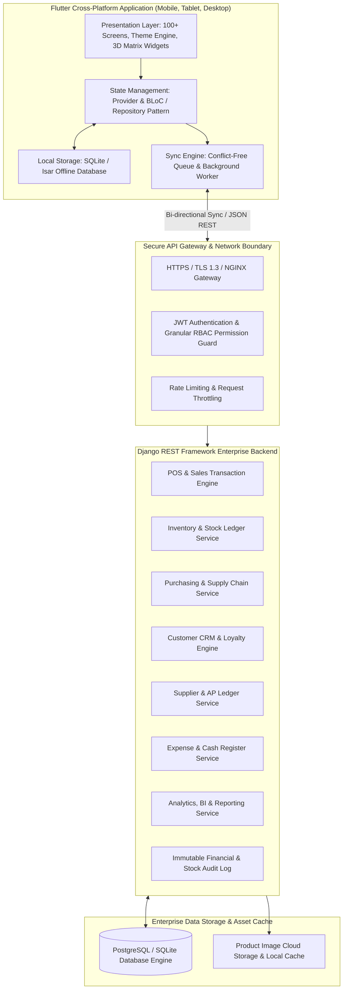

# 🏛️ MINI MARKET — SYSTEM ARCHITECTURE SPECIFICATION

**Document Version**: 1.0.0  
**Target Environment**: Enterprise Production Retail System  
**Frameworks**: Flutter 3.x (Multi-Platform Client) & Django 5.x / Django REST Framework (Backend)  

---

## 1. High-Level Architectural Blueprint

Mini Market is structured as an **Offline-First, Tiered Enterprise Architecture** with decoupled presentation, domain, and persistent data tiers.



---

## 2. Flutter Client Architectural Pattern (Clean Architecture)

The Flutter codebase is organized according to **Feature-Driven Clean Architecture**, ensuring strict separation of concerns, testability, and zero code duplication across 100+ screens.

```text
lib/
├── core/
│   ├── config/              # Environment configurations, app constants, feature flags
│   ├── constants/           # Route names, asset keys, storage keys
│   ├── database/            # Local SQLite database migrations & helper
│   ├── network/             # Dio/Http client, JWT interceptor, error handler, retry policy
│   ├── sync/                # Offline mutation queue, synchronization worker, conflict resolver
│   ├── theme/               # Light/Dark design system, typography, glassmorphism tokens
│   ├── utils/               # Currency formatter (decimal-safe), barcode validator, date tools
│   └── widgets/             # Reusable enterprise components (dialogs, tables, cards, charts)
├── data/
│   ├── datasources/         # Remote API data sources & Local database DAOs
│   ├── models/              # DTOs with robust JSON serialization & immutability
│   └── repositories/        # Repository implementations orchestrating local vs remote data
├── domain/
│   ├── entities/            # Pure business entities (Product, Sale, StockMovement, Customer)
│   ├── repositories/        # Abstract repository contracts
│   └── usecases/            # Pure business use cases (ProcessSaleUseCase, AdjustStockUseCase)
└── presentation/
    ├── app_shell/           # Responsive navigation rail, drawer, bottom navigation
    ├── state/               # State providers (AuthState, POSState, InventoryState, ReportState)
    └── screens/             # 100+ organized domain screen modules
```

---

## 3. Offline-First Synchronization Architecture

Retail cashiers cannot afford interruption if network connectivity fluctuates. The POS subsystem operates under an **Offline-First Optimistic Execution** paradigm:

1. **Local Mutation**: When a cashier finalizes a sale or performs an inventory count offline:
   - The transaction is recorded immediately in the local SQLite database.
   - Local stock quantities are decremented optimistically.
   - An immutable mutation entry is appended to the local `SyncQueue` with a UUID, UTC timestamp, and SHA-256 payload checksum.
2. **Connectivity Listener**: A persistent connection monitor detects network recovery.
3. **Queue Replay**: Mutations are batched and transmitted to `/api/sync/batch/` using idempotent execution headers.
4. **Conflict Resolution**:
   - *Financial & Sales Transactions*: Additive log model (never overwritten).
   - *Inventory Levels*: Handled via stock movement delta journals (`+N` or `-N`), preventing race-condition overwrites.
   - *Master Data (Products/Prices)*: Server-authoritative resolution with client cache update.

---

## 4. Backend Service Architecture (Django REST Framework)

The backend follows a modular, domain-driven structure within `backend/apps/`:

### 4.1 Modular App Breakdown
- **`apps.core`**: Base models (`TimeStampedModel`), standard pagination, global exception handlers, money serialization.
- **`apps.accounts`**: Custom User model, Role-Based Access Control (`Role`, `PermissionGroup`), cashier shift assignments, JWT endpoints.
- **`apps.products`**: Products, Barcodes, Categories, Brands, Department classification, Unit of Measures, Pricing tiers.
- **`apps.inventory`**: Stock ledger, stock movements (`StockIn`, `StockOut`, `Damage`, `Adjustment`, `Transfer`), low-stock thresholds, batch/lot tracking, expiry tracking.
- **`apps.pos`**: Point of Sale sessions, Cash Register shifts, Sales transactions, Sale items, split payment processing, receipt generation.
- **`apps.purchases`**: Purchase orders (PO), Goods Received Notes (GRN), purchase invoices, purchase returns.
- **`apps.suppliers`**: Supplier directory, contact information, payment terms, Accounts Payable (AP) ledger.
- **`apps.customers`**: Customer CRM profiles, loyalty points ledger, customer credit limits, Accounts Receivable (AR) ledger.
- **`apps.expenses`**: Store operational expenses, expense categories, petty cash tracking, receipt image attachments.
- **`apps.reports`**: High-performance analytical aggregates, gross profit calculation, sales velocity, dead stock detection, tax summaries.
- **`apps.audit`**: Immutable audit logs capturing every user action, financial edit, and stock variance.

---

## 5. Security & Financial Precision Architecture

### 5.1 Financial Correctness Guardrails
- **Floating Point Prohibition**: IEEE-754 floating point arithmetic (`float`/`double`) is strictly banned for monetary calculations.
- **Backend Standard**: Python `Decimal` (`decimal.Decimal`) mapped to database `DecimalField(max_digits=14, decimal_places=2)`.
- **Frontend Standard**: Dart `Decimal` / fixed-point integer cents with strict rounding rules (`MidpointRounding.toEven`).
- **Server Calculation Authority**: Cart subtotals, tax rates, line-item discounts, and final totals are recalculated and verified authoritatively on the backend before committal.

### 5.2 Atomic Database Transactions
All multi-table mutations (such as completing a POS sale, which writes to `Sale`, `SaleItem`, `Payment`, `StockMovement`, and `CustomerPoints`) are wrapped inside database transactions:
```python
with transaction.atomic():
    # 1. Lock affected inventory rows
    product = Product.objects.select_for_update().get(id=product_id)
    # 2. Validate stock sufficiency
    # 3. Create Sale & SaleItems
    # 4. Record StockMovement
    # 5. Record Payment & Audit Log
```

### 5.3 Authentication & Authorization
- **Token Model**: Short-lived JWT Access Tokens (15 min) paired with Refresh Tokens (7 days) featuring rotation.
- **Permission Matrix**: Granular permission checks enforced on both viewsets and model signals:
  - `CanMakeSales`
  - `CanModifyPrices`
  - `CanViewFinancialReports`
  - `CanManageInventory`
  - `CanApprovePurchases`
  - `CanManageEmployees`
